# VoxelCraft HD 3.1.2

Jogo sandbox de blocos para **Android** (WebView) e **PC** (Electron), feito em JavaScript com Three.js r160
(a mesma versão do original). A versão 3.0 transforma o VoxelCraft num sandbox completo: mundo procedural
com 14 biomas, cavernas, minérios e estruturas, sobrevivência com fome e armaduras, fabricação, fornalha e
baús, animais, monstros e aldeões com trocas e missões, mecanismos (alavancas, fios, pistões, trilhos),
clima com chuva, neve e raios, mapa, saves em IndexedDB, personalização de skin com braço em 1ª pessoa,
multiplayer em rede local e atualização automática.

**Downloads (gerados por esta versão):**
- Android: [`dist/VoxelCraft-HD.apk`](dist/VoxelCraft-HD.apk)
- Windows: `VoxelCraft-HD.exe`. Ele foi enviado diretamente no chat por ter 71 MB, e pode ser gerado de novo
  com `npm run dist` (veja abaixo). O `.exe` não fica mais no repositório porque a CDN da atualização
  automática tem limite de tamanho.

| | |
|---|---|
| 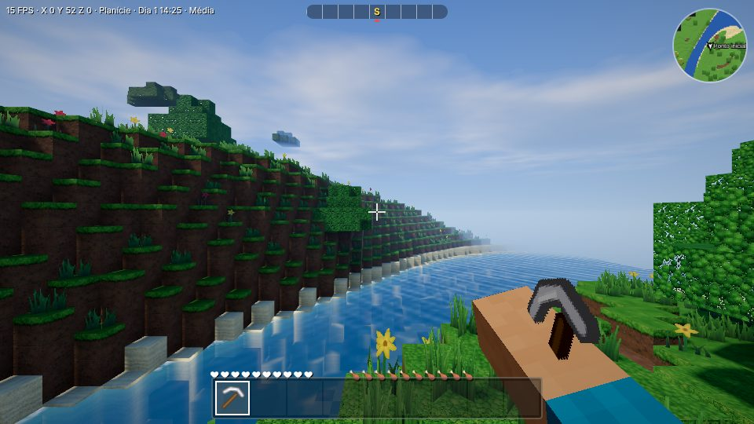 | 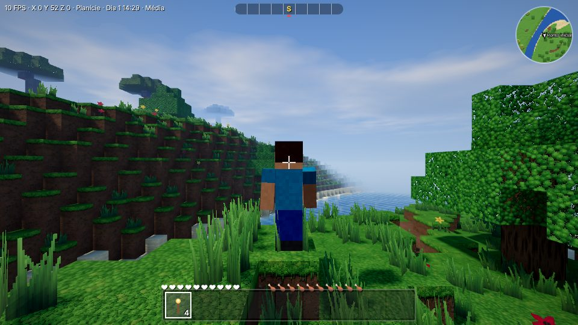 |
| 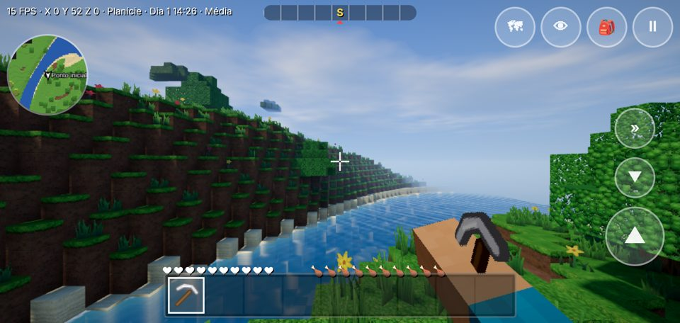 | 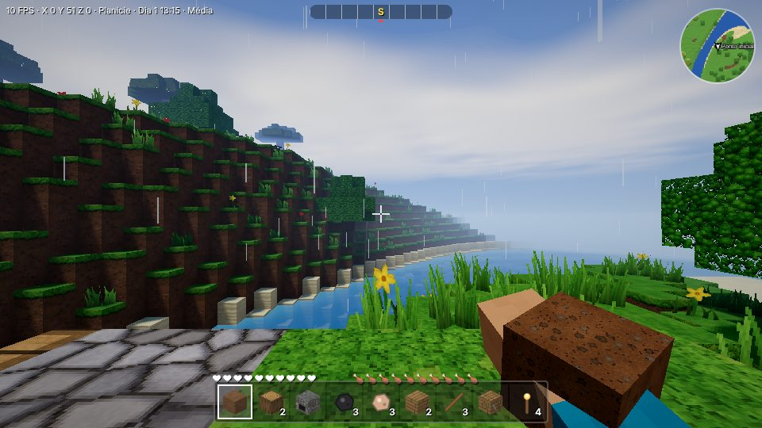 |
| 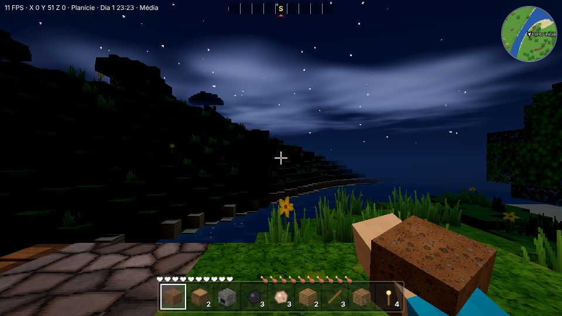 | 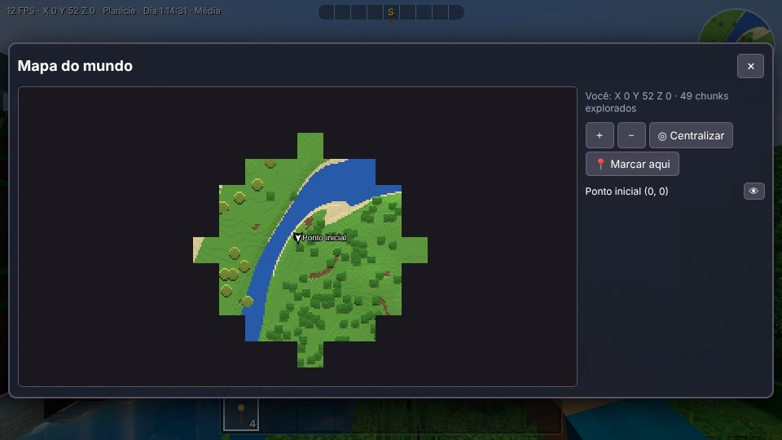 |
| 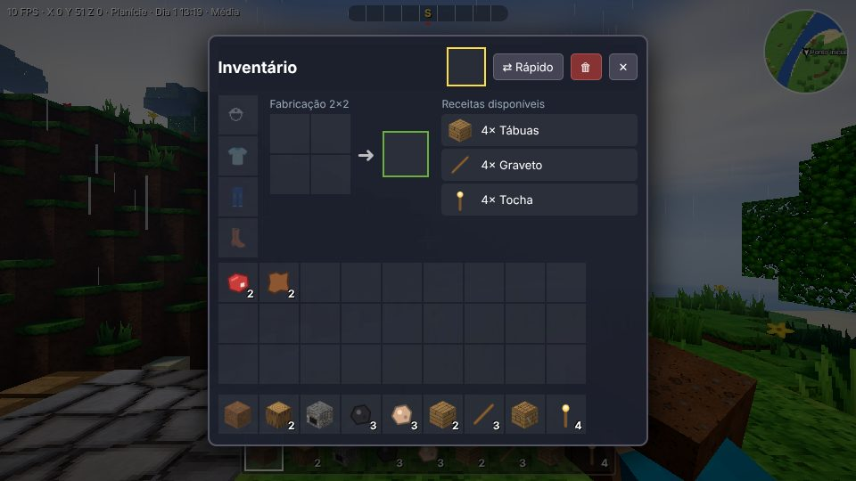 | 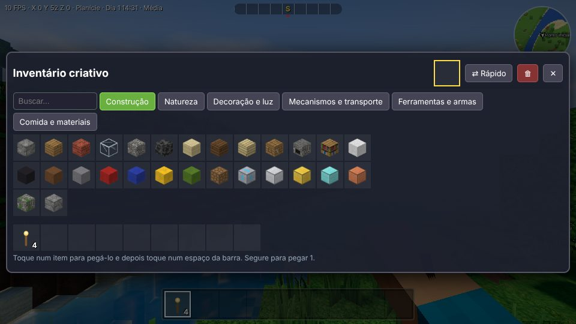 |

## Novidades da 3.3.0

- **Tocha na mão ilumina em volta**: segurar tocha, lâmpada, lava (balde), cristal ou fornalha acesa cria uma luz dinâmica que acompanha o jogador, com tremulação e acendimento suave. Funciona em todos os presets (inclusive no celular). No multiplayer, a tocha na mão dos 2 jogadores mais próximos também ilumina (com "Luzes dinâmicas" ligadas). Opção "Tocha na mão ilumina em volta" nas configurações gráficas.
- **Jogabilidade**: pulo mais responsivo (dá para pular logo após sair da borda e o pulo apertado um pouco antes de tocar o chão é guardado), pulo correndo com impulso, corrida continua no ar, dois toques em W para correr (PC), controle no ar melhor, nado rápido (correr debaixo d'água segue o olhar) e impulso para sair da água pela borda.

## Novidades da 3.2.0

- **Preset "Extremo (PC)"**: sombras em 3 cascatas de 4096 px até 170 blocos, SSAO com 16 amostras, até 8 luzes dinâmicas (2 com sombra), nuvens volumétricas reais, TAA, distância de visão 12 e resolução 150%.
- **Nuvens volumétricas reais** (opção "Volumétricas reais (PC)"): raymarching com 22 passos, luz do sol atravessando a nuvem, sombras das nuvens no chão alinhadas à altura delas.
- **Texturas mais nítidas**: o pacote de texturas é ampliado com filtro bicúbico (Catmull-Rom) em vez de bilinear.
- **PC começa no Ultra**: instalações novas no PC usam Ultra; quem estava em Alta sobe uma vez para Ultra (a qualidade automática reduz se o FPS cair).
- **Atualização automática durante o jogo**: verifica a cada 20 minutos (e ao voltar para o app); mostra "Nova versão disponível — Atualizar agora" (salva o mundo e recarrega). Depois mostra "Jogo atualizado para a versão X". Botão "Verificar atualizações agora" em Configurações → Geral.

## Novidades da 3.1.2

- **Texturas novas:** os blocos usam o pacote de texturas da imagem enviada (`app/src/main/assets/textures/pack.png`,
  16×6 células na ordem dos tiles do jogo). O relevo é calculado a partir da própria imagem; plantas, tochas,
  escadas, trilhos, fios e vidro têm o fundo escuro removido. Ficaram com a textura procedural: topo da acácia
  (a célula trazia uma abóbora), portas e os blocos novos da 3.1 (fogo, TNT, estalactite, cipó), que não estão
  na imagem. Dá para voltar às texturas antigas em Configurações Gráficas → Pacote de texturas.
- **Reflexos corrigidos:** a água agora grava profundidade, então SSAO, raios de sol, TAA e desfoque não
  desenham mais os blocos do fundo por cima da superfície (o padrão de "cubos brancos"), e a exposição
  automática foi recalibrada (antes clareava a cena inteira em ~1,6×).

## Novidades da 3.1

| | |
|---|---|
| 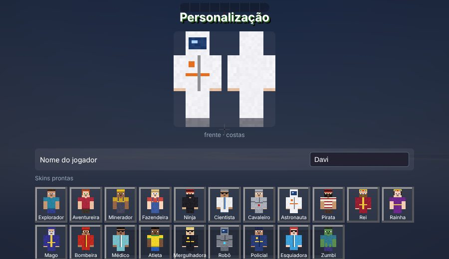 | 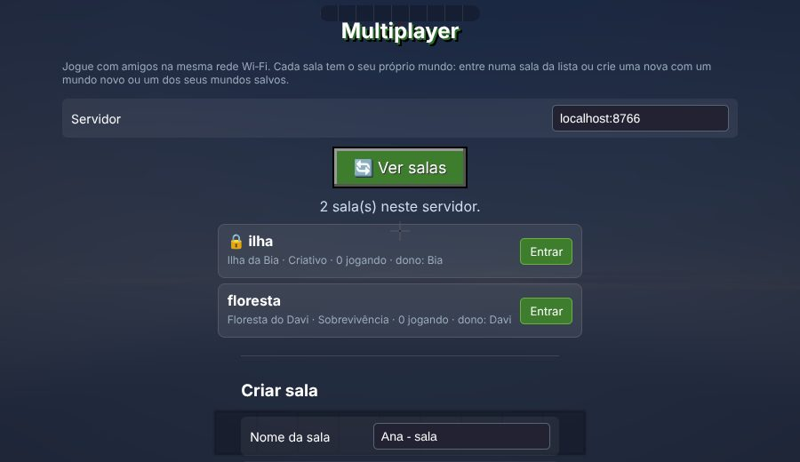 |
| 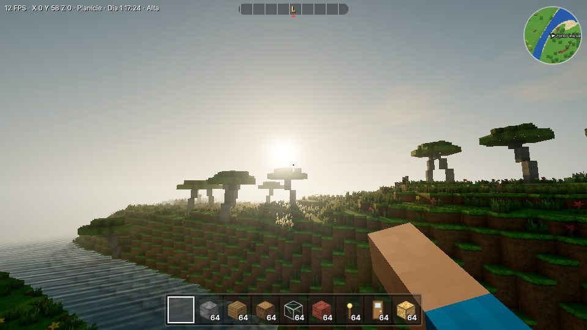 | 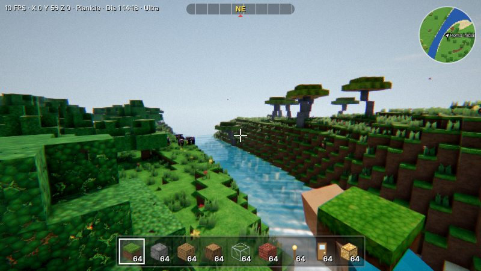 |
| 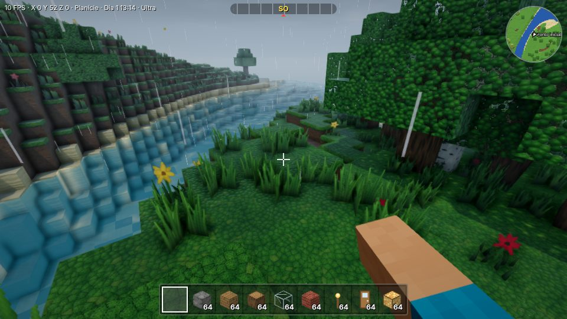 | 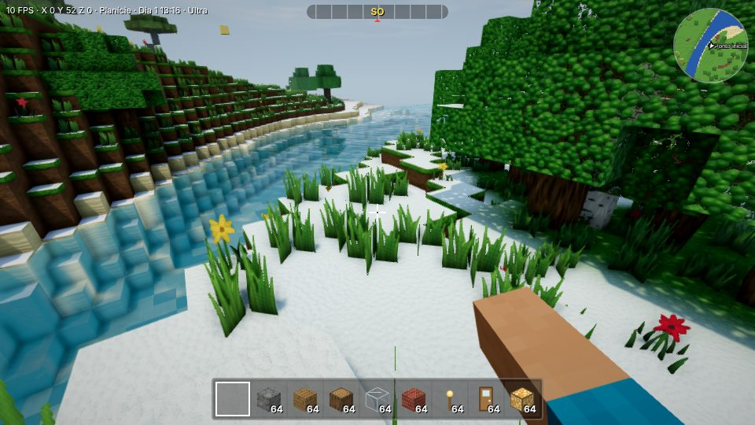 |

**Skins:** 20 skins prontas (explorador, cavaleiro, astronauta, pirata, rei, rainha, mago, bombeira,
robô, zumbi...), roupas (manga longa, listrada, camisa de time, jaleco, macacão, jardineira, armadura,
túnica, vestido, rasgada), chapéus (boné, capacete, coroa, capuz, faixa, capacete com viseira), barba,
óculos, cor de detalhe, skin aleatória, **importar PNG 64×64** (formato padrão de skins de jogos de blocos,
inclusive o antigo 64×32; a camada externa é achatada) e exportar PNG. A prévia mostra frente e costas, e
a skin aparece para os outros jogadores no multiplayer.

**Multiplayer com salas de mundos diferentes:** o menu Multiplayer lista as salas do servidor, com
cadeado, nome do mundo, modo, quem está jogando e quem é o dono. Para entrar, toque na sala. Para criar,
dê um nome, uma senha opcional e escolha **mundo novo** (nome, semente, modo) ou **um dos seus mundos
salvos**. Cada sala guarda o próprio mundo no servidor. Quem criou a sala é o dono (identificado por uma
chave guardada no aparelho): pode bloquear construção, expulsar, trocar a senha e `/apagar` a sala. No
PC, "Ligar servidor neste PC" abre o servidor embutido e mostra o endereço para os amigos.

**Diálogos próprios:** renomear/excluir mundo, chat, senha e marcadores do mapa usavam `prompt()`/
`alert()`, que **não aparecem na WebView do Android**. Agora tudo usa janelas do próprio jogo (o chat é
uma caixa de texto na tela).

**Realismo, em 8 etapas (cada efeito tem opção no painel e nível por preset):**

| Etapa | O que entrou |
|---|---|
| 1. Iluminação | Sombras em cascata (até 3 mapas, estabilizadas e misturadas nas bordas), céu por dispersão atmosférica (Rayleigh + Mie + ozônio: entardecer laranja, hora azul), cor do sol pela atmosfera, luz ambiente por sonda de harmônicos esféricos com o rebote colorido do chão, luz das tochas com queda ~1/d² e tremulação, luzes dinâmicas nas 2–4 fontes mais próximas (lava avermelhada, cristal azul), sombra da tocha mais próxima (Ultra), SSAO em meia resolução, raios de sol (god rays), lua com fases e estrelas que giram |
| 2. Materiais | Chuva molha (escurece, deixa brilhante, poças), neve acumula no topo dos blocos expostos, variação de cor em grande escala e sujeira nos cantos, detalhe de alta frequência de perto, relevo parallax (Ultra), sombra das nuvens no chão |
| 3. Água e atmosfera | Ondas de Gerstner (vértice e normal), absorção por profundidade (Beer-Lambert), neblina de vale (mais densa de madrugada e depois da chuva), neblina subaquática com absorção por cor, gotas de chuva na tela, relâmpago iluminando a cena |
| 4. Vegetação e vida | Plantas se afastam quando o jogador passa, folhas translúcidas contra o sol, folhas caindo das copas, vaga-lumes à noite, poeira/pólen no ar, brasas perto de lava e fornalhas, bando de pássaros, borboletas |
| 5. Câmera e pós | Exposição automática (o olho se adapta entre caverna e céu aberto), TAA, desfoque de movimento da câmera, profundidade de campo, reflexos do sol na lente (só se o sol estiver visível), aberração cromática, granulação, bloom com limiar físico |
| 6. Animação | Criatura tomba ao morrer, respiração, inclinação ao correr, cabeça que acompanha o jogador, degraus suaves, impacto ao pousar, balanço lateral da câmera, inércia da mão, tremor em explosões |
| 7. Som | Som 3D (HRTF) para criaturas e trovões, eco por ambiente (caverna, floresta, aberto), oclusão por blocos, passos na água, chuva abafada sob telhado, vento mais forte no alto e na tempestade |
| 8. Física e mundo | Água e lava escorrem com níveis (fonte, corrente, cachoeira, secam sem fonte; água infinita), lava + água vira pedra/pedregulho, fogo que se espalha e é apagado pela chuva, isqueiro de pederneira, TNT (fogo, isqueiro ou circuito) com destruição, destroços, dano e empurrão, areia e cascalho caem como entidade, barcos balançam; **gerador de terreno 4** (mundos novos) com vales de erosão, falésias, estalactites/estalagmites e cipós |

**Modo foto** (tecla P ou Pausa → Modo foto): esconde a HUD, câmera livre, qualidade máxima temporária,
foco (profundidade de campo), mudar a hora, captura em PNG (no PC baixa o arquivo; no celular fica na
galeria do modo foto). **Benchmark** (Configurações → Geral): voa 20 s num trajeto fixo e mostra FPS
médio, 1% mais lentos e tempo de GPU (quando o aparelho permite), com histórico para comparar.

## O que foi implementado (e está funcionando)

**Renderização**
- Chunks de 16×128×16. A geração e a malha de cada chunk rodam em Web Workers, e as edições do jogador
  são remalhadas na hora na thread principal. Frustum culling do Three.js, fila de prioridade por
  distância e limite de malhas por quadro.
- Iluminação voxel com luz do céu e luz de blocos (tochas, lâmpadas, lava, cristal) por flood fill,
  iluminação suave e oclusão de ambiente por vértice.
- Formas de bloco reais: degraus, lajes, cercas, portões, portas, painéis de vidro, tochas, escadas de
  mão, camas, mesas, cadeiras, alavancas, botões, placas de pressão, fios, trilhos (inclusive curvas e
  rampas), pistões e cactos. A colisão e a seleção usam a forma exata.
- Sombras PCF estabilizadas, água com reflexo planar, ondas, espuma e cáusticas, céu atmosférico,
  nuvens volumétricas, neblina e vegetação com vento (tudo da v2 foi mantido).
- Pós-processamento modular: render HDR, bloom, tone mapping ACES, correção de cor, vinheta e FXAA.
- Perda de contexto WebGL é tratada (o jogo pausa e recarrega as texturas).

**Mundo**
- Gerador novo com continentes, colinas, montanhas, rios e lagos e 14 biomas: oceano, praia, planície,
  floresta, floresta densa, bétulas, deserto, savana, pântano, taiga, montanha, montanha nevada,
  terreno rochoso e rio.
- Cavernas 3D com lagos de lava no fundo. Minérios por profundidade: carvão, cobre, ferro, ouro,
  diamante e cristal.
- Estruturas: aldeias com casas, poço, plantações, postes de luz e caminhos; ruínas; templos no
  deserto; masmorras com baús de tesouro.
- Semente configurável. Mundos antigos mantêm o gerador original, e as construções continuam intactas.

**Sobrevivência e itens**
- Vida, fome, saciedade, ar debaixo d'água, regeneração, dano de queda, afogamento, lava e cactos.
  Armadura reduz o dano e gasta durabilidade. Ao morrer você deixa os itens no chão e renasce na cama
  ou no ponto inicial.
- 82 blocos, 164 itens e 109 receitas: grade 2×2 no inventário, mesa de trabalho 3×3, livro de receitas,
  fornalha com combustível e baús.
- Ferramentas de madeira, pedra, ferro, ouro e diamante com velocidade, nível de mineração e
  durabilidade. Também há espadas, arco e flechas, tesoura, enxada, baldes, armaduras de 4 materiais e
  comidas.
- Inventário com pilhas, barra rápida, dividir pilha (segurar), modo rápido, descartar (lixeira ou Q) e
  equipar armadura. Funciona no toque e no mouse.
- Plantações (trigo em 4 estágios), mudas que viram árvores, farinha de osso, grama que se espalha,
  areia e cascalho que caem.

**Criaturas**
- Animais: vaca, porco, galinha, ovelha (com lã tosquiável e cores), coelho, cavalo (3 pelagens,
  montável com sela) e peixes. Eles vagam, fogem quando apanham, seguem você quando está com a comida
  certa, se reproduzem e soltam itens.
- Monstros: zumbi (corpo a corpo) e esqueleto (arqueiro). Surgem no escuro e à noite e queimam ao sol.
  O modo Pacífico desliga os monstros.
- Aldeões com 5 profissões, nomes, rotina de dia e noite (voltam para casa e abrem portas), trocas por
  moedas e missões: coletar, derrotar e explorar.

**Mecanismos e veículos**
- Alavanca, botão, placa de pressão, fio com nível de energia, lâmpada que acende, portas e portões
  automáticos, pistão que empurra até 12 blocos, elevador.
- Barco, carrinho de mina em trilhos (com curvas) e cavalo.

**Modos de jogo:** Sobrevivência, Criativo (voo, itens infinitos, quebra instantânea), Pacífico (sem
monstros, a fome não mata) e Desafio (17 objetivos em sequência, com dano maior).

**Saves:** vários mundos no IndexedDB, com criar, abrir, renomear, duplicar, exportar/importar (arquivo
.json) e apagar (com confirmação). Cada mundo guarda nome, semente, modo, posição, inventário, edições,
baús, fornalhas, criaturas, hora, clima, mapa e progresso. Há salvamento automático a cada 30 s e ao
sair. São usados dois slots alternados com checksum: se um estiver corrompido, o jogo usa o outro e
avisa. O mundo da versão anterior é migrado automaticamente.

**Mapa:** coordenadas, bússola, minimapa, mapa do mundo com zoom e arraste (pinça no celular), regiões
exploradas, marcadores próprios, aldeias e local da morte.

**Personalização:** nome, 20 skins prontas, roupas, chapéus e importação de PNG (veja Novidades), e ainda cores de pele, cabelo, olhos, camisa, calça e sapatos,
estilo de cabelo e prévia. O **braço do personagem aparece em 1ª pessoa** com a skin escolhida e o
item na mão, e a 3ª pessoa mostra o modelo completo (V/F5 ou botão 👁 alterna 1ª, 3ª por trás e 3ª pela
frente). Também há sensibilidade, FOV, inverter eixo, tamanho da interface, alto contraste e redução
de flashes.

**Clima:** céu limpo, chuva e tempestade com raios e trovões (atraso pela distância). Neve nos biomas
frios. Chuva e neve não atravessam telhados.

**Multiplayer (rede local):** servidor autoritativo em Node.js (`server/`), também embutido no app de PC
(botão **Hospedar sala**). Tem salas com senha, sincronização de posição, blocos, criaturas, hora e
clima, chat, nomes e skins, e reconexão automática (até 5 tentativas). O inventário e a posição de cada
jogador ficam guardados no servidor. O servidor valida coordenadas, ids, alcance, taxa de edições e
permissões (`/construir off`, `/expulsar <nome>`, `/senha`, `/jogadores`). Se o anfitrião sair, outro
jogador assume a simulação.

**Atualização automática (PC e celular):** ao abrir com internet, o jogo consulta `update.json` neste
repositório. Se houver versão mais nova, carrega o código novo direto da CDN (jsDelivr, com Statically e
GitHack como reserva). Sem internet, abre a versão embutida. Dá para desligar em Configurações →
Geral → "Atualizar o jogo automaticamente".

## Controles

| PC | Celular | Ação |
|---|---|---|
| WASD + mouse | joystick (lado esquerdo) + arrastar | andar / olhar |
| Espaço / Shift | ▲ / ▼ | pular (subir voando) / agachar (descer) |
| Ctrl | » (liga/desliga) ou joystick no máximo | correr |
| Clique esquerdo (segurar) | tocar e segurar | quebrar / atacar |
| Clique direito | toque rápido | colocar / usar / comer / interagir |
| 1–9, roda do mouse | barra rápida | escolher item |
| E ou I | 🎒 | inventário |
| F | botão "voar" (criativo) | voar |
| V ou F5 | 👁 | câmera 1ª/3ª pessoa |
| M | 🗺 | mapa |
| T | 💬 (no multiplayer) | chat |
| Q | lixeira no inventário | descartar |
| Esc | ⏸ | pausa / menu |

## Configurações Gráficas

Presets **Baixa / Média / Alta / Ultra** (ou Personalizada), aplicados na hora e salvos:

| Opção | Efeito real |
|---|---|
| Texturas | Atlas de 32/64/128 px com relevo (normal map) e filtro anisotrópico |
| Distância de renderização | 2 a 12 chunks |
| Sombras | Desligadas ou mapa de 1024 a 4096 px |
| Água | Simples → ondas → espuma e cáusticas → reflexos planares |
| Vegetação, nuvens, iluminação, neblina | Densidade, tipo e intensidade |
| Pós-processamento | Desligado / tone mapping + cor / + bloom / + FXAA, com bloom, vinheta e correção de cor individuais |
| Partículas | Densidade de 0 a 150% |
| Antialiasing, resolução | MSAA; escala de 50% a 200% |
| Limite de FPS, modo economia, ajuste automático | Para celulares mais fracos |
| Sombras do sol | Desligadas / 1 mapa / 2 cascatas / 3 cascatas 1024 / 3 cascatas 2048 |
| SSAO, luzes dinâmicas, sombra da tocha, raios de sol | Oclusão de ambiente em tela, 0/2/4 luzes, sombra da fonte mais próxima |
| Materiais | Simples / Médio (chuva, neve, variação) / Alto (+ detalhe, sombra de nuvens) / Ultra (+ parallax) |
| Céu | Clássico ou físico (dispersão atmosférica) |
| Pós avançado | Exposição automática, TAA, desfoque de movimento, profundidade de campo, reflexos de lente, gotas na tela, aberração cromática, granulação |

**O que cada preset liga (novos efeitos):**

| Efeito | Baixa | Média (padrão no celular) | Alta (padrão no PC) | Ultra |
|---|---|---|---|---|
| Sombras | — | 1 mapa 1024 | 3 cascatas 1024 | 3 cascatas 2048 |
| SSAO | — | — | baixa | alta |
| Luzes dinâmicas | — | — | 2 | 4 + sombra da tocha |
| Raios de sol, reflexos de lente | — | — | sim | sim |
| Materiais | simples | médio | alto | ultra (parallax) |
| Exposição automática, gotas na tela | — | sim | sim | sim |
| Aberração cromática, granulação | — | — | — | sim |
| TAA, desfoque de movimento, profundidade de campo | opcional | opcional | opcional | opcional |

**Custo estimado por efeito em celular intermediário** (não medido em aparelho: use o benchmark):
sombras em 3 cascatas 1024 ≈ 1,5–2,5 ms, 3×2048 ≈ 3–4 ms; SSAO ≈ 1,5–3 ms; raios de sol ≈ 0,4–0,8 ms;
2–4 luzes dinâmicas ≈ 0,5–1 ms; sombra da tocha ≈ 2–4 ms; materiais Alto ≈ 0,5–1 ms (Ultra + parallax
≈ 1 ms); exposição automática ≈ 0,1 ms; TAA ≈ 0,5–1 ms; desfoque de movimento ≈ 1 ms; profundidade de
campo ≈ 1–1,5 ms; céu físico e sonda de luz ≈ 0 na GPU (calculados na CPU só quando o sol anda).

## Estrutura do código

```
app/src/main/assets/               o jogo (mesmos arquivos no APK, no EXE e na CDN)
  boot.js / version.js / update.json   inicialização + atualização automática
  main.js        orquestração: menus → mundo → loop, ações, morte, cama, multiplayer
  state.js       estado global e "hooks" entre módulos
  noise.js, worldgen.js, worldgen-worker.js   ruído, biomas, cavernas, minérios, estruturas
  blocks.js, tiles.js       definições de blocos (propriedades, formas, colisão) e texturas
  world.js, mesher.js       chunks, edições, luz voxel e geração de malha (também usado no worker)
  textures.js, textures2.js, atlas-worker.js   texturas procedurais (albedo, normal, rugosidade/AO)
  render.js, shaders.js, postfx.js   renderizador, céu, água, sombras, pós-processamento
  lighting.js    sombras em cascata, céu físico, sonda de luz ambiente, luzes dinâmicas (3.1)
  ambient.js     vaga-lumes, poeira, folhas caindo, brasas, pássaros e borboletas (3.1)
  worldphys.js   água/lava escorrendo, fogo, explosões (3.1)
  tools.js       modo foto e benchmark (3.1)
  dialog.js      diálogos próprios (substituem prompt/alert na WebView) (3.1)
  physics.js, player.js     colisão por caixas, raycast, jogador e sobrevivência
  items.js, crafting.js, icons.js   itens, inventário, receitas, fornalha, ícones
  gameplay.js     quebrar/colocar/usar blocos, baús, fornalhas, plantas, ticks
  entities.js, mobs.js, models.js, villagers.js   criaturas, IA, veículos, modelos, trocas e missões
  mechanics.js    energia (alavanca, fio, lâmpada, pistão, portas)
  hand.js         braço em 1ª pessoa e modelo em 3ª pessoa
  weather.js, particles.js, audio.js   clima, partículas, sons sintetizados
  ui.js, menus.js, input.js, mapview.js, challenge.js   HUD, telas, controles, mapa, modo desafio
  saves.js, idb.js          saves em IndexedDB com recuperação
  net.js         cliente multiplayer
server/            servidor multiplayer (Node.js + ws) e teste automático do protocolo
desktop/           app de PC (Electron): main.js, preload.js (Hospedar sala), copy-assets.js
app/src/main/java/.../MainActivity.java   wrapper WebView (Android)
tools/build_apk.py         gera o APK assinado sem Android SDK
tools/publish_update.py    publica uma atualização automática
tools/base/VoxelCraft-wrapper.apk   wrapper Android compilado (com permissão de internet)
```

## Como gerar e testar

### APK (sem Android SDK)
Requer Python 3 e Java 11+:
```bash
python3 tools/build_apk.py        # → dist/VoxelCraft-HD.apk (assinado, esquemas v2+v3)
adb install -r dist/VoxelCraft-HD.apk
```
O APK original não tinha a permissão de **internet**, então a atualização automática e o multiplayer não
funcionariam no celular. O wrapper foi refeito com o [apktool](https://github.com/iBotPeaches/Apktool)
(`tools/base/VoxelCraft-wrapper.apk`). Ele adiciona `INTERNET`, `ACCESS_NETWORK_STATE` e
`usesCleartextTraffic`, libera conteúdo misto na WebView (para `ws://` na rede local), sobe a versão
para 3.0.0 (versionCode 3) e remove `debuggable`. O código-fonte Java e o manifesto do projeto foram
atualizados do mesmo jeito para quem compila com Gradle (`./gradlew assembleRelease`).

> É **preciso instalar este APK novo uma vez** (por cima da v2, com a mesma assinatura). A partir daí, as
> próximas versões chegam sozinhas.

### EXE (Windows)
```bash
cd desktop && npm install
npm start          # roda no PC atual
npm run dist       # → desktop/dist/VoxelCraft-HD.exe (portátil, x64)
```

### Servidor multiplayer dedicado
```bash
cd server && npm install
node server.js 8765          # salas salvas em server/data/
npm test                     # teste automático do protocolo (19 verificações)
```
No celular ou no PC, abra **Multiplayer** e digite o endereço mostrado pelo servidor (ex.: `192.168.0.10:8765`),
a sala e a senha. No app de PC, use **Multiplayer → Hospedar sala com um mundo...**. Todos precisam
estar no mesmo Wi-Fi (o Windows pode pedir para liberar o app no firewall).

### Publicar uma atualização automática
```bash
python3 tools/publish_update.py 3.0.1 "o que mudou"
git push
```
O script grava a versão, faz commit do código e aponta `update.json` para esse commit. Os aparelhos com
a 3.0.0 ou mais nova baixam a versão nova na próxima abertura com internet. O manifesto é lido do branch
`ccr-57277497-q2k9gm`. Se o projeto mudar de branch, ajuste `BRANCH` em `boot.js` antes de gerar o
próximo APK/EXE.

### Testar no navegador
```bash
python3 -m http.server 8000 --directory app/src/main/assets   # abra http://localhost:8000
```

## Testes realizados (Chromium headless com renderização por software)

Todos passaram sem erros no console:
- **Gameplay:** iniciar sobrevivência; quebrar terra (o item cai e é recolhido); cadeia de fabricação
  (tábuas, gravetos, mesa, tocha, fornalha); tempos de mineração (pedra: 7,5 s na mão, 1,1 s com
  picareta de madeira); minério de ferro só sai com picareta de pedra; fornalha (3 ferros brutos viram
  3 lingotes, 6 s cada).
- **Mecanismos:** alavanca → fio (energia 14) → lâmpada liga e desliga; alavanca abre a porta; pistão
  estende e empurra.
- **Criaturas e clima:** vaca derrotada solta carne e couro; animais surgem por bioma; zumbi e esqueleto
  aparecem à noite; tempestade com chuva.
- **Saves:** salvar e recarregar mantém edições (18/18), inventário, criaturas e dados de baú/fornalha.
- **Telas:** inventário, criativo, mapa, 1ª/3ª pessoa e layout de celular com toque, conferidos por
  captura de tela.
- **Multiplayer:** teste de protocolo com 19/19 verificações (senha, alcance, ids inválidos, limite de
  taxa, permissões, chat, criaturas, troca de anfitrião, persistência após reiniciar, inventário na
  reconexão). Também foi testado com dois navegadores no servidor real: o convidado recebe o mundo,
  vê o anfitrião e vice-versa, um bloco colocado aparece no outro, uma edição fora de alcance é desfeita,
  as criaturas aparecem nos dois e o convidado vira anfitrião quando o primeiro sai.
- **App de PC (Electron no Linux):** "Hospedar sala" inicia o servidor embutido e um cliente externo
  entra na sala.
- **3.1:** todos os presets (Baixa, Média, Alta, Ultra e Ultra com TAA + desfoque + profundidade de
  campo) compilam e desenham sem erros de shader; modo foto captura PNG; servidor com **29/29**
  verificações (lista de salas, mundos diferentes por sala, nome repetido recusado, sala apagada pelo
  dono, dono reabre com outro mundo); dois navegadores criando salas diferentes (sementes 12345 e 999,
  sobrevivência e criativo) e um terceiro entrando pela lista; skins: 20 prontas, importação de PNG
  válida e recusa de imagem inválida; física: água escorre com níveis 0→7, seca sem a fonte, cai em
  cachoeira, lava + água vira pedra, fogo consome tábuas, areia cai e pousa, TNT destrói 53 de 75 pedras;
  gerador 4 gera estalactites e vales sem mudar o gerador 3 dos mundos existentes.
- **Atualização automática (simulada):** manifesto e CDN interceptados. A versão 3.0.1 "remota" é
  carregada, inclusive os workers; quando a primeira CDN falha, a reserva assume; sem internet, abre a
  versão local.

## Limitações e pendências

- **Não testado em aparelho real.** Os testes rodaram em navegador desktop com renderização por
  software (10 a 17 FPS). O desempenho no celular depende do aparelho; use Baixa/Média e o ajuste
  automático. Não há garantia de 60 FPS.
- **Atualização automática:** a CDN real não pôde ser acessada daqui (o ambiente bloqueia jsDelivr), então
  o fluxo foi testado só por simulação. Ela depende de o repositório continuar **público**. Mudanças no
  wrapper nativo (Java, manifesto, Electron) exigem instalar um APK/EXE novo.
- **Multiplayer:** funciona em rede local (ou com o servidor exposto na internet com porta liberada;
  não há servidor público hospedado). Itens dropados e projéteis são locais de cada jogador. O
  inventário fica no cliente e o servidor só guarda uma cópia (não há validação de crafting). Baús e
  fornalhas não são sincronizados entre jogadores.
- **Efeitos 3.1 sem medição em celular:** os custos acima são estimativas. Neste ambiente de teste
  (renderização por software) o jogo roda a poucos quadros por segundo em qualquer preset, então não
  dá para afirmar que Alta chega a 60 FPS num Snapdragon 7 — rode o benchmark no aparelho.
- **Não implementado da lista de realismo:** reflexo em espaço de tela (a água usa reflexo planar no
  Ultra e o céu nos outros), refração na água, nuvens volumétricas com raymarch e reprojeção (as nuvens
  continuam 2D com sombreamento, agora projetando sombra), desfoque de movimento por objeto (só da
  câmera), IK de pés, ragdoll com física (a criatura tomba numa animação), pássaros/peixes com IA
  (pássaros e borboletas são decorativos), erosão hidráulica simulada (o gerador 4 usa ruído que imita
  vales de erosão), cor diferente por fonte de luz no flood fill (a cor vem das luzes dinâmicas).
- TAA pode deixar rastro em criaturas que se movem rápido (a reprojeção considera só a câmera); fica
  desligado nos presets.
- A água que escorre só é simulada pelo anfitrião/jogo solo; mexer perto de um oceano pode inundar
  túneis (como no jogo original de blocos). Não há redstone com atraso (repetidores).
- Neve acumulada é um efeito visual perto do jogador (não vira bloco).
- Sem sons gravados: os efeitos são sintetizados (WebAudio).
- O `.exe` não é assinado digitalmente (o SmartScreen avisa na primeira vez) e não tem ícone próprio.
- A chave do APK é a de `tools/voxelcraft.keystore`. Instalar por cima da versão original da outra
  máquina exige desinstalar antes, e isso apaga os saves dela.
