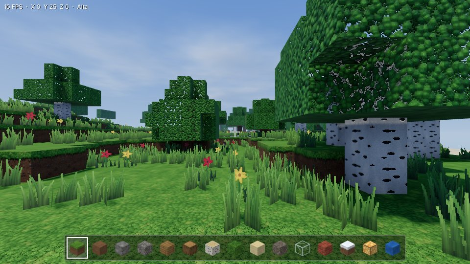
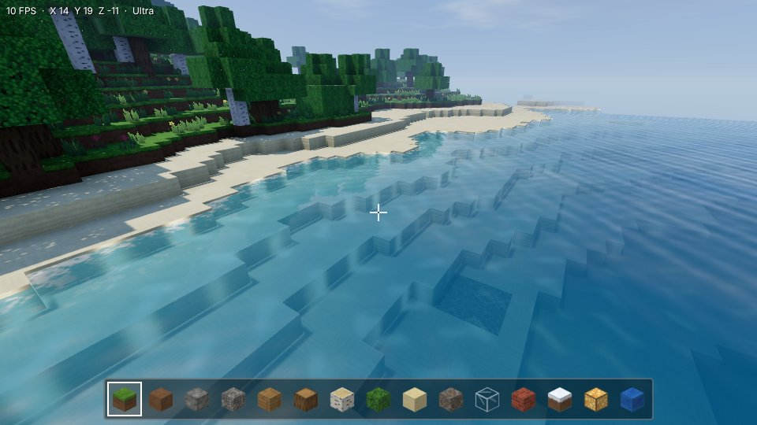
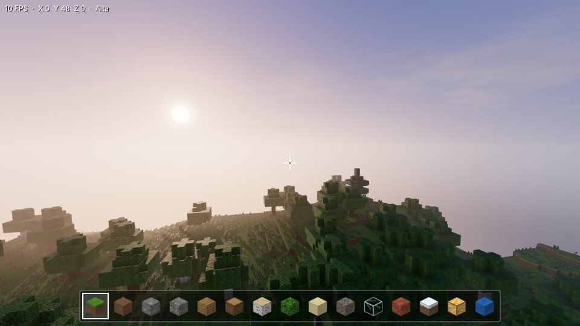
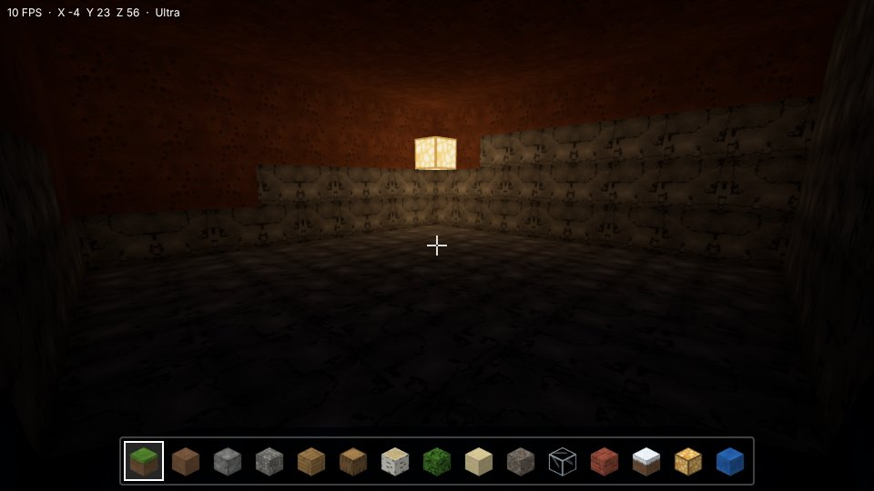
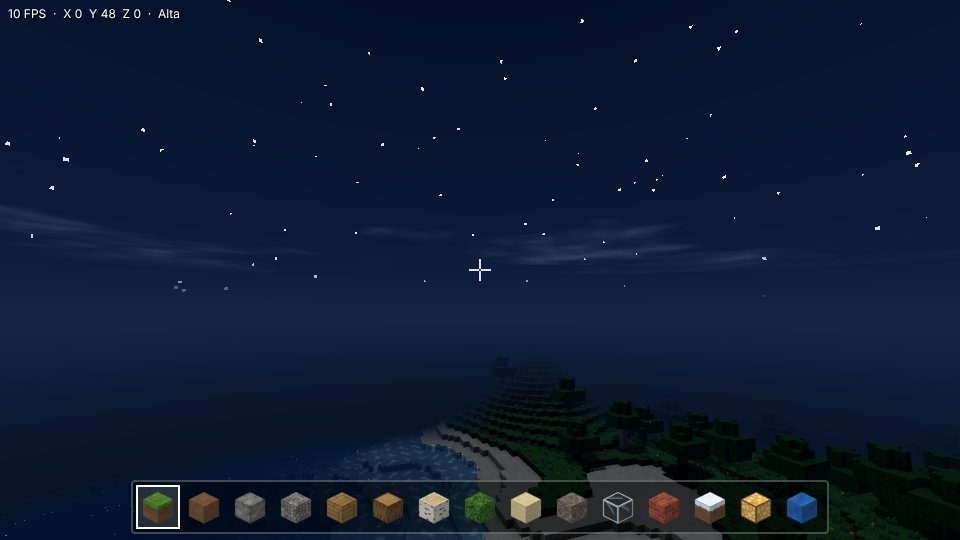
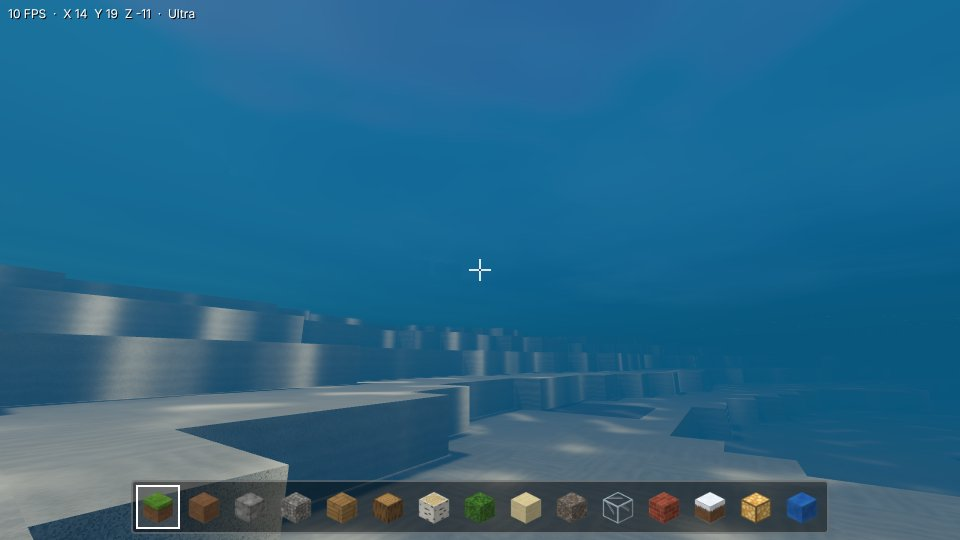

# VoxelCraft HD

Jogo de construção em blocos para Android (WebView + Three.js r160), agora com renderização realista:
texturas procedurais em alta resolução com relevo, iluminação voxel (luz do céu e de lâmpadas), sombras
dinâmicas suaves, água com ondas, reflexos e espuma, céu atmosférico com ciclo dia/noite, nuvens
volumétricas, vegetação com vento e um painel de **Configurações Gráficas** completo.

**APK pronto:** [`dist/VoxelCraft-HD.apk`](dist/VoxelCraft-HD.apk)

| | |
|---|---|
|  |  |
|  |  |
|  |  |

> O APK novo é assinado com uma chave diferente da versão original (que usava a chave de debug de
> outra máquina). Se a versão antiga estiver instalada, o Android pede para desinstalá-la antes, e isso
> apaga o mundo salvo. Mundos salvos continuam compatíveis com o código novo quando ficam no mesmo app.

## Estrutura

```
app/src/main/assets/          ← o jogo (é aqui que fica quase todo o código)
  index.html, style.css       interface (HUD, menu, painel gráfico)
  main.js                     mundo, iluminação voxel, mesher, física, controles, renderização
  textures.js                 gerador procedural das texturas (albedo, normal, rugosidade/AO)
  shaders.js                  céu, nuvens, água, neblina e injeção de iluminação nos materiais
  graphics.js                 presets, persistência e painel de Configurações Gráficas
  lib/three.module.min.js     Three.js r160 (mesma versão do original, não foi atualizada)
app/src/main/java/.../MainActivity.java   wrapper WebView (reconstruído do APK original)
tools/build_apk.py            gera o APK assinado sem Android SDK
tools/base/VoxelCraft-original.apk        APK original (base do empacotamento)
dist/VoxelCraft-HD.apk        APK gerado
```

## Como gerar o APK

### Opção 1: sem Android SDK (recomendado para mudanças só no jogo)

Requer Python 3 e Java 11+.

```bash
python3 tools/build_apk.py            # gera dist/VoxelCraft-HD.apk
adb install -r dist/VoxelCraft-HD.apk
```

O script reaproveita o wrapper Android compilado do APK original, troca a pasta `assets/` pelos arquivos
atuais, alinha (zipalign) e assina (v1+v2+v3) com `tools/voxelcraft.keystore`. Na primeira execução ele
baixa o [uber-apk-signer](https://github.com/patrickfav/uber-apk-signer), que traz o `apksigner` e o
`zipalign` oficiais do Android.

### Opção 2: Android Studio / Gradle

Abra a pasta do projeto no Android Studio (AGP 8.5.2, Gradle 8.7, compileSdk 34) ou rode:

```bash
./gradlew assembleRelease
# APK em app/build/outputs/apk/release/app-release.apk
```

## Testar no navegador

```bash
python3 -m http.server 8000 --directory app/src/main/assets
# abra http://localhost:8000 (WASD + mouse; F voa; 1-9 escolhe bloco)
```

## Configurações Gráficas

No menu: **Configurações Gráficas**. Tudo é salvo em `localStorage` e aplicado na hora (o antialiasing
reinicia o renderizador e retoma o jogo automaticamente).

| Opção | O que muda de verdade |
|---|---|
| Qualidade gráfica | Presets Baixa / Média / Alta / Ultra (ou Personalizada) |
| Qualidade das texturas | Atlas de 32, 64 ou 128 px por bloco; relevo (normal map) a partir de 64 px; filtro anisotrópico |
| Distância de renderização | 2 a 12 chunks (32 a 192 blocos) |
| Qualidade das sombras | Desligadas, ou mapa de sombras de 1024 a 4096 px, alcance de 36 a 80 blocos, PCF suave |
| Intensidade da iluminação | Multiplica a luz do sol, da lua e do céu (50% a 160%) |
| Qualidade da água | Simples → ondas + reflexo do céu → brilho do sol, espuma e cáusticas → reflexos planares reais |
| Densidade da vegetação | Grama alta e flores sobre a grama (nenhuma/baixa/média/alta) |
| Nuvens | Desligadas / simples / volumétricas (sombreamento por marcha de raios) |
| Antialiasing | MSAA do WebGL |
| Resolução de renderização | 50% a 200% da resolução da tela |
| Neblina | Liga/desliga e densidade da neblina atmosférica |
| Limite de FPS | 30 / 60 / sem limite |
| Modo economia | Força sombras e água simples, texturas de 32 px, resolução de 60%, distância de até 4 chunks e limite de 30 FPS |
| Ajuste automático | Se o FPS ficar abaixo de ~62% do alvo por 5 s, desce um preset |

## Como testar cada efeito

- **Sombras:** em Alta/Ultra, fique perto de árvores de dia. As folhas projetam sombra recortada e
  balançam com o vento.
- **Oclusão de ambiente:** cantos entre blocos e o encontro entre paredes e chão ficam mais escuros.
- **Luz do céu / ambientes fechados:** cave um túnel ou feche uma casa. O interior escurece aos poucos
  conforme se afasta da entrada.
- **Lâmpada (bloco novo, último slot antes da água):** coloque numa caverna ou à noite. A luz quente se
  espalha por até 14 blocos.
- **Água:** em Média ou mais há ondas e reflexo do céu. Em Alta aparecem espuma nas margens, brilho do
  sol e cáusticas no fundo. Em Ultra, árvores e terreno são refletidos de verdade. Mergulhe para ver a
  neblina subaquática.
- **Céu:** o dia dura 10 minutos. Observe o amanhecer, o pôr do sol dourado, a lua, as estrelas e as
  nuvens se movendo.
- **Variação:** grama e folhas mudam de tom por região, e as texturas giram aleatoriamente para quebrar
  a repetição. Mundos novos têm bétulas, pinheiros nas montanhas e cascalho no fundo do mar.

## Limitações conhecidas

- O APK gerado sem SDK mantém `versionCode 1` (o manifesto binário original é reaproveitado). O build
  pelo Gradle usa `versionCode 2`.
- As sombras dinâmicas cobrem até 80 blocos ao redor do jogador. Além disso, a luz do céu faz a sombra
  aproximada (áreas cobertas escurecem).
- Os reflexos planares (Ultra) valem para a água no nível do mar. Água colocada em outras alturas
  reflete o céu.
- A grama alta e as flores são decorativas: não têm colisão e não podem ser quebradas.
- Mundos salvos na versão antiga mantêm o gerador original de terreno e árvores, para não alterar
  construções existentes. Bétulas, pinheiros e cascalho só aparecem em mundos novos.
- O desempenho foi medido em navegador desktop com renderização por software. Em celulares, o ajuste
  automático de qualidade compensa aparelhos mais fracos.
